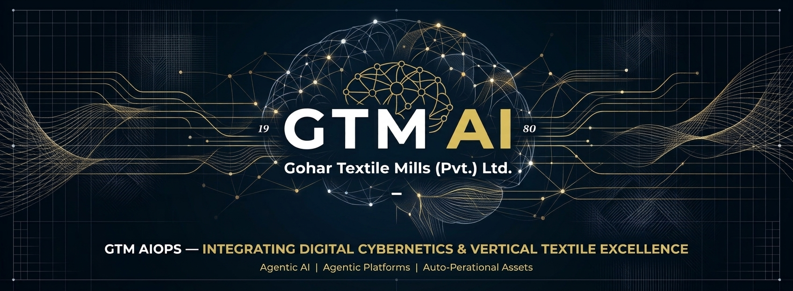

<div align="center">

# GTM AiOps

### Agentic AI Platforms, Operations, and Assets Management

**Owned By: "GTM AI" Department**

**Gohar Textile Mills (Pvt.) Ltd. (GTM)**

[](https://www.gohartextile.com/)

**GTM AI: A Cybernetics — The Digital Organizational Brain of GTM... 🧠🐺**

</div>

## About GTM

[Gohar Textile Mills (Pvt.) Ltd.](https://www.gohartextile.com/) is a vertically integrated
home-textile manufacturer serving wholesalers, retailers, distributors, and
outlets worldwide. Its public product portfolio includes bedding, hospitality
textiles, products for children, curtains, table linen, and bedding
accessories.

GTM combines textile experience, design, manufacturing, quality, and
international operations with a continuing commitment to innovation. Its
integrated capabilities provide a strong foundation for applying artificial
intelligence to real operational work responsibly and at scale.

## About the GTM AI Department

**GTM AiOps** is the public engineering identity of the **GTM AI Department and
its team**. The department focuses on the responsible design, implementation,
integration, and operation of **agentic AI platforms, intelligent automations,
and AI-assisted business capabilities**.

Our purpose is to connect people, knowledge, business processes, digital
systems, and physical operations through governed AI. We aim to help teams
understand operational conditions, reduce repetitive work, make better-informed
decisions, and turn approved decisions into reliable action.

AI at GTM is intended to augment accountable teams. Business owners, domain
experts, engineers, designers, and operators remain responsible for material
decisions and outcomes.

## Our mission

Build a secure and measurable AI capability that can support GTM across the
full lifecycle of work:

```text
Observe → Understand → Recommend → Approve → Act → Measure → Improve
```

This lifecycle is the basis of our **Cybernetics** direction: a digital
organizational brain that connects trusted signals with organizational
knowledge, human judgment, controlled action, and continuous feedback.

## Core objectives

- **Governed agentic AI** — provide shared identity, policy, safety, cost,
  monitoring, and audit controls for approved AI applications and agents.
- **Workflow intelligence and automation** — reduce repetitive handling of
  documents, records, communications, approvals, and routine operational work.
- **Operational intelligence** — transform authorized business and operational
  data into timely summaries, exceptions, recommendations, and decision
  support.
- **Enterprise knowledge** — make approved procedures, documents, technical
  knowledge, and organizational context easier to find and use.
- **AI-assisted engineering** — help technical teams understand, develop, test,
  document, and maintain software through controlled development workflows.
- **Design and product assistance** — explore AI-supported discovery, briefing,
  concept preparation, knowledge retrieval, and repetitive design operations
  while preserving designer authority.
- **Assets and production intelligence** — develop safe, evidence-based ways to
  understand equipment, quality, maintenance, energy, and production
  performance, beginning with offline and read-only use cases.
- **Responsible adoption** — measure quality, reliability, usability, cost, and
  business value before expanding a solution.

## Areas of focus

### Agentic AI platforms

Reusable foundations for connecting approved models, data, tools, workflows,
and applications. These foundations are designed to support multiple teams
without scattering credentials, policies, or operational responsibility.

### AI automations

Human-centered workflows that can extract and structure information, apply
business rules, request approval, use supported interfaces, record outcomes,
and route exceptions to the appropriate owner.

### Knowledge and decision support

Permission-aware assistants that help people work with approved organizational
knowledge and evidence. Important outputs should be traceable to their sources,
scope, and freshness.

### Operations and assets management

AI-supported monitoring, analysis, and recommendations for business operations
and physical assets. Safety-critical and production-control responsibilities
remain with qualified people and established control systems.

### Evaluation and reliability

Practical evaluation of AI quality, access boundaries, failure behavior,
latency, cost, user adoption, and accepted business outcomes. A convincing demo
is only the beginning; a useful service must remain secure, observable,
recoverable, and maintainable.

## Engineering principles

1. **Business purpose before technology**  
   Begin with a real problem, an accountable owner, and a measurable outcome.

2. **Human accountability**  
   AI may prepare, explain, recommend, or draft. Material actions require the
   appropriate rules, permissions, and human authority.

3. **Security and least privilege**  
   Give every user, service, and agent only the information and capabilities
   required for its approved purpose.

4. **Evidence over confidence**  
   Preserve sources, versions, validations, approvals, and final outcomes. AI
   confidence alone is not business evidence.

5. **Systems of record remain authoritative**  
   AI services work through approved application and integration boundaries;
   they do not bypass established transactional or safety controls.

6. **Read before write**  
   Start with search, explanation, analysis, and recommendations. Add controlled
   actions only after access, quality, failure, and recovery behavior are
   proven.

7. **Reliable automation**  
   Design for retries, duplicate prevention, reconciliation, monitoring,
   recovery, manual fallback, and clear exception ownership.

8. **Measured expansion**  
   Begin with bounded use cases, compare results with a baseline, and scale only
   when the evidence supports it.

## Current direction

The GTM AI Department, represented here by GTM AiOps, is establishing the
foundations for an organization-wide AI capability. The current direction
includes:

- defining governance, security, ownership, and evaluation practices;
- developing reusable patterns for agentic applications and automations;
- identifying bounded use cases with clear owners and success measures;
- validating integrations in controlled environments;
- documenting architectures, engineering standards, and operating practices;
- building organizational capability through experimentation and learning.

Projects and repositories may represent research, prototypes, reference
designs, shared components, or approved production services. Their individual
documentation will identify the applicable status and boundaries.

## What you may find here

Where appropriate for public release, this GitHub profile may host:

- reference architectures and engineering guidance;
- reusable agent, automation, and integration components;
- evaluation tools, test fixtures, and reliability patterns;
- developer utilities and documentation;
- selected experiments, prototypes, and demonstrations;
- open-source contributions that support responsible enterprise AI.

## Public information and responsible disclosure

Public repositories must not contain confidential business information,
customer or employee data, credentials, proprietary designs, production
configuration, security-sensitive details, or restricted operational records.

Examples and reference designs published here should not be interpreted as a
description of GTM's live environment or as confirmation that a capability has
been deployed. Production status, where relevant and suitable for public
disclosure, will be stated explicitly.

## Connect with GTM

- **Website:** [www.gohartextile.com](https://www.gohartextile.com/)
- **Organization:** Gohar Textile Mills (Pvt.) Ltd.
- **AI department and team:** GTM AiOps — Agentic AI Platforms, Operations,
  and Assets Management

---

<div align="center">

**Building governed intelligence for people, operations, and assets.**

</div>
